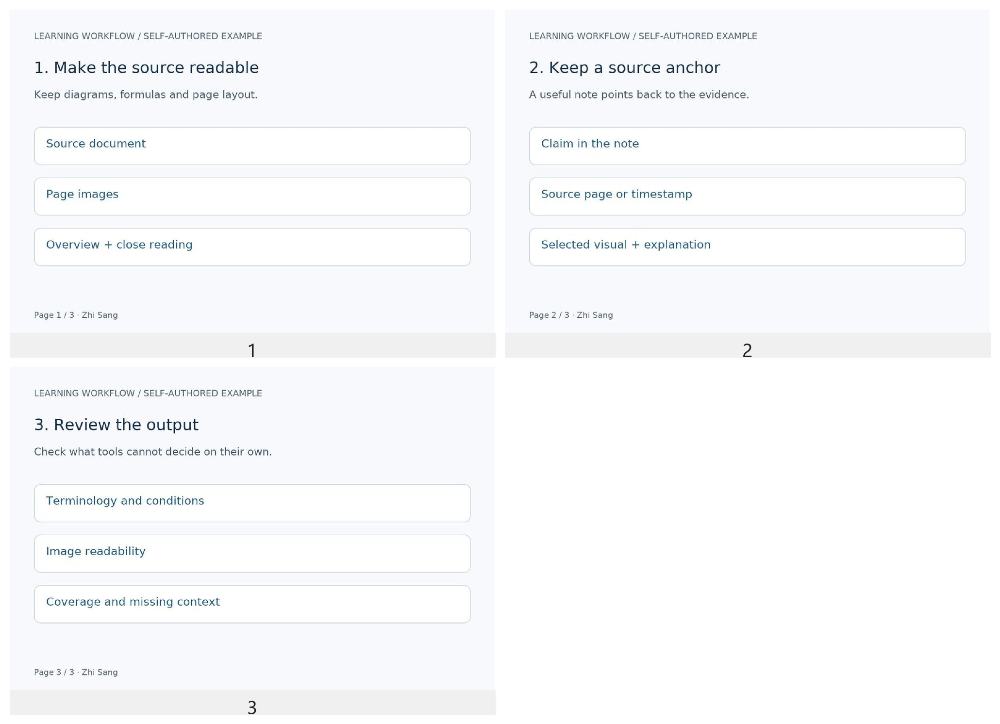

# Learning Automation Toolkit

[简体中文](README.zh-CN.md) · [Project background](https://sang4242.pages.dev/en/projects/course-automation/) · [Sources and attribution](docs/sources.md)

Scripts and working conventions I use to turn documents and video material into illustrated Markdown notes. They grew from individual conversion tools into a workflow that combines page images, transcription, time alignment, selected video frames and source references.

The tools carry out concrete operations. An AI assistant reads the material, decides when a closer visual check is needed, selects useful frames and writes the notes according to the workflow. This repository contains those tools and conventions, not a single end-to-end note-generation application.

## What's included

| Directory | Contents |
| --- | --- |
| `tools/documents/` | Word/PPT to PDF, PDF page rendering, batch inputs, engine-aware Office caches and image-stitching integration. |
| `tools/images/` | Labeled image grids and remote-image localization into Typora-style `.assets` directories. |
| `tools/media/` | Qwen3-ASR HTTP client with low-energy chunking/concurrency/VAD, Forced Aligner integration, sentence timestamp lookup and subtitle conversion. |
| `tools/mineru/` | MinerU API client, batch polling and Markdown/assets result organization. |
| `workflows/` | [Slide workflow](workflows/slides.md) and [video workflow](workflows/video.md), currently written in Chinese for the AI assistant. |
| `examples/` | Self-authored input, reproducible processing steps and finished Markdown notes. |
| `tests/` | Model-free regression checks. |

Canvas and course-platform acquisition/query tools remain separate associated projects. The reusable material-processing part is collected here; the broader personal Hub and private course library stay outside the repository.

## Start with the examples



- [Slide notes](examples/slide-notes.md): source page → selected figure → explanation and page reference.
- [Video notes](examples/video-notes.md): sentence ID → timestamp → extracted frame → Markdown image reference.
- [Example builder](examples/build_demo.py): creates the source slides/PDF and a 15-second silent video, then runs the conversion, stitching, subtitle and frame steps.

The example's subtitles and time index are authored in the builder. They demonstrate lookup and visual processing; they are not ASR or forced-alignment output. Real ASR and alignment require the optional model setup below.

## Install and reproduce the lightweight path

Python 3.10+ is required; the current base checks used Python 3.13 on Windows 11. Install ImageMagick 7 with Ghostscript for PDF rendering, and FFmpeg for the video example. Keep `magick`, `ffmpeg` and `ffprobe` on PATH.

```powershell
git clone https://github.com/SANG4242/learning-automation-toolkit.git
cd learning-automation-toolkit
python -m pip install -r requirements.txt
python examples/build_demo.py
python -m unittest discover -s tests -v
```

The builder writes generated source assets under `examples/input/`, the preview under `examples/preview/`, and intermediate pages under `.local/`. It regenerates its own example files. Open the notes in Typora or GitHub to inspect the final result.

### Process your documents

```powershell
python tools/documents/pdf2img.py input.pdf --pages 1-3 --output .local/pages
python tools/documents/doc2img.py input.docx --engine office
python tools/documents/ppt2img.py slides.pptx --engine libreoffice --libreoffice-path 'C:/Program Files/LibreOffice/program/soffice.com'
python tools/images/image_stitcher.py -i .local/pages --preset 4
python tools/images/localize_md_images.py notes --dry-run
```

Word/PPT conversion uses installed WPS, Microsoft Office or LibreOffice. Office/WPS COM execution is Windows-specific. PDF rendering and image scripts can be used independently. Office defaults follow the original tools: `docx2pdf` uses WPS; the other Office entry points use Microsoft Office unless an engine is specified.

Image localization modifies Markdown in place when `--dry-run` is omitted. Review the target directory and keep a version-controlled copy. PDF `--force` moves existing page images into a `previous/` subdirectory before regenerating them. Its normal page cache is based on existing output files; force regeneration after changing a source PDF or output settings.

## Optional speech and alignment

The model weights and GPU environment are separate from the base Python requirements.

1. Install the client dependencies with `python -m pip install -r requirements/asr-client.txt`.
2. Prepare a Linux/WSL vLLM environment supporting Qwen3-ASR. The original local setup used vLLM 0.22.0; this public launcher has not yet been retested against a clean GPU environment. `tools/media/start_vllm_asr.sh` is a parameterized foreground launch recipe. Set `QWEN_ASR_MODEL` to the model name/path and adjust memory utilization to the machine.
3. Start the service yourself and point the client at its health/audio-transcription endpoints. The public client neither starts WSL automatically nor stops other model processes.

```powershell
$env:QWEN_ASR_MODEL = 'Qwen/Qwen3-ASR-1.7B'
$env:LEARNING_AUDIO_DIR = 'C:/study/audio'
python tools/media/transcribe_qwen_vllm.py --file lesson.mp4 --url http://localhost:8000 --out-dir .local/transcripts
```

The request's model name must match the service's served model. Output includes `transcript.md`, `chunks.json` and chunk audio. For alignment, install a CUDA-compatible PyTorch environment and `requirements/alignment.txt`, then run:

```powershell
python tools/media/align_qwen.py .local/transcripts/lesson_qwen_vllm/chunks.json --model Qwen/Qwen3-ForcedAligner-0.6B
python tools/media/query_timestamp.py .local/transcripts/lesson_qwen_vllm/sentences.jsonl S00001
```

On a small GPU, stop the ASR server through your own process manager before loading the aligner. Sentence lookup supports IDs, normalized text and string similarity; the AI assistant maps a concept back to the relevant wording. It is not a vector search engine.

### Configuration

| Variable | Purpose |
| --- | --- |
| `LEARNING_TOOLS_DATA_DIR` | Intermediate/cache root; defaults to repository `.local/`. |
| `LEARNING_AUDIO_DIR` / `LEARNING_TRANSCRIPT_DIR` | ASR input/output roots. |
| `QWEN_ASR_URL` / `QWEN_ASR_MODEL` | ASR service URL and request model. |
| `QWEN_ALIGNER_MODEL` | Aligner path/name. |
| `SILERO_VAD_MODEL` | Local VAD ONNX path; missing weights may be downloaded from the upstream URL. |
| `FFMPEG_BIN_DIR` / `LIBREOFFICE_PATH` | Optional external-program locations. |
| `MINERU_API_TOKEN` | Required only for the cloud MinerU client. |

## Optional structured parsing

```powershell
python tools/mineru/mineru_pdf2md.py --help
python tools/mineru/mineru_pdf2md.py submit document.pdf --output .local/mineru
```

Set `MINERU_API_TOKEN` in your environment first. This route uploads material to the external MinerU service; choose it only for material you intend to send there. Page-image reading is a separate local route. The public API client has syntax/CLI checks; a real API request remains to be retested.

## Verification in this release

- Three-page PDF rendering and stitching, authored subtitle conversion, timestamp lookup, silent-video generation and FFmpeg extraction ran successfully; the overview and selected frame were visually reviewed.
- Seven model-free unit tests cover page selection, safe names, timestamps, text lookup, sentence splitting, zero-second subtitles and image filenames.
- The release process checks Python syntax, CLI entry points, local Markdown references and credentials before upload.
- The public ASR/aligner GPU environment, Office COM engines and cloud MinerU request still need dedicated end-to-end verification. No general transcription-speed claim is made from the example.

## Using it with an AI assistant

Give the assistant the input paths, intended audience, output location and the appropriate `workflows/` file. It needs permission to run the scripts and a way to inspect images. A useful output keeps a source anchor, explains figures in context and separates the source material from added explanations. Review the finished notes against the original.

## License and upstream software

The repository's own scripts and authored examples are [MIT](LICENSE). Models, document engines and APIs retain their own licenses and terms. See [sources and scope](docs/sources.md) for the implementation/engine split.
