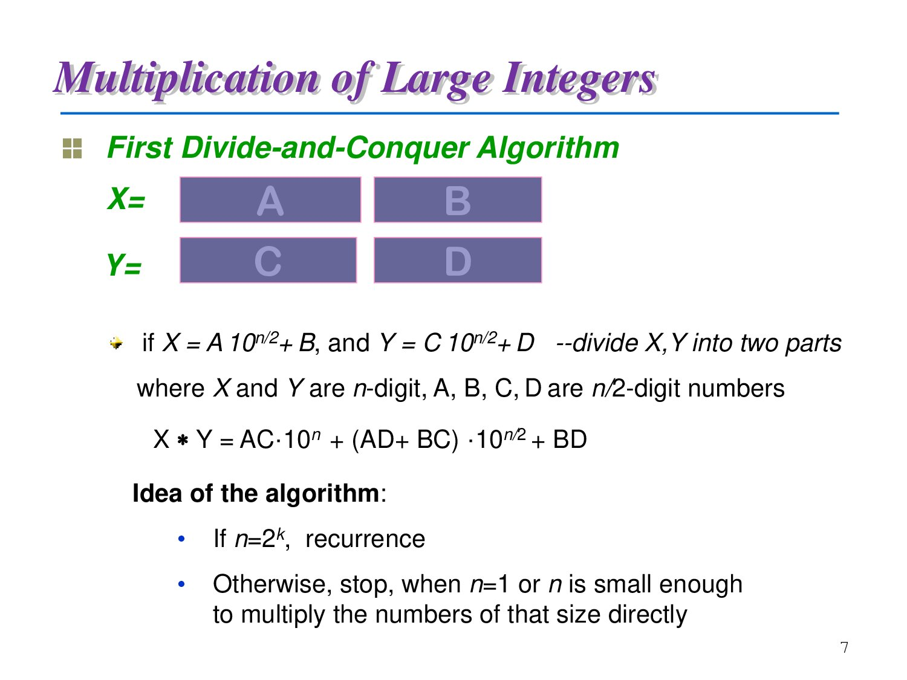

# 真实课程案例：从一节分治法课到完整笔记

[English](README.en.md) · [工具链首页](../../README.zh-CN.md) · [整体架构](../../docs/architecture.md)

## 来源与演示用途

本案例选自我在同济大学学习“算法设计与分析”时的实际资料：2026 年 4 月 2 日课堂的完整 ASR 转录和概述，以及 2026 年 5 月 7 日整理的 Ch5 分治法章节笔记。

**课程课件和课堂转录经许可公开，仅用于演示这套工具链的完整整理效果。** 课件与课堂内容保留原作者／授课者的权利，不适用仓库代码的 MIT 授权，也不因此取得再发布许可。来源课件文件名保留，课程为算法设计与分析，授课教师罗烨。

## 先怎样看

1. 从[本课概述](.agent/asr概述/2026-04-02_Ch5.md)了解讲授范围与课件页码映射。
2. 打开[完整 ASR 转录](ASR转录/算法设计与分析_2026-04-02_qwen_vllm.md)，查看课堂实际表达与分块标记。
3. 对照[Ch5 完整课件](课件/+Chapt5E%20Divide%20and%20Conquer%20.pdf)与[完整章节笔记](笔记/ch5_分治法.md)，观察内容如何组织、图片如何引用。
4. 需要了解规则和资料导航时，读取[案例入口](.agent/memory.md)及[原课程上下文](.agent/context/原课程上下文.md)。

## 完整材料清单

| 层次 | 文件 | 作用 |
| --- | --- | --- |
| 课堂原文 | `ASR转录/算法设计与分析_2026-04-02_qwen_vllm.md` | 完整保留机器转录的 39 个分块及无人声占位 |
| ASR概述 | `.agent/asr概述/2026-04-02_Ch5.md` | 按转录段落映射课件，归纳课堂重点和补充 |
| 主课件 | `课件/+Chapt5E Divide and Conquer .pdf` | 分治框架、大整数乘法、矩阵乘法、二分查找、排序、棋盘覆盖 |
| 复习课件 | Ch3 蛮力法、Ch4 递归算法 PDF | 对应当天开始时的复习及主定理前置内容 |
| 章节笔记 | `笔记/ch5_分治法.md` | 完整章节讲解、推导、伪代码、例子与比较 |
| 配图 | `笔记/ch5_分治法.assets/` | 27 张课件截图，其中25张由笔记正文引用 |
| 历史课程规则 | `.agent/context/原课程上下文.md` | 原有目录组织、资料映射、课程约定和内嵌工作流程的公开副本 |

课堂材料对应4月2日的讲授，5月7日整理的章节笔记按Ch5的知识结构组织。笔记中的主定理链接指向随附Ch4课件第13页。

## 这套材料展示什么

- ASR 原文保留口语、重复和识别误差；概述负责快速定位与课堂信息提取；章节笔记承担系统讲解。
- 教师额外强调的表示、进位、长度不齐等实现问题，可以从转录回查，并与课件和笔记对照。
- 图片放在同名 `.assets/`，笔记在 Typora 和 GitHub 中可直接打开。
- 资料、规则和当前工作位置由 `.agent` 导航，不需要每个新窗口重新交代。

该课程的任务流程保存在当时的课程入口中。按任务安装插件的目录和配置方式见[插件示例](../plugin-course/README.md)。

公开材料保留原文结构，课堂点名、学号与私人联系方式已匿名化，资料引用指向案例内文件。
