# Ch5 分治法 Divide and Conquer

> 📅 整理日期：2026-05-07 | 📖 来源：+Chapt5E Divide and Conquer .pdf

---

## 📌 整体概览

本章介绍**分治法（Divide and Conquer）**——一种将问题拆分成若干**相同类型、规模更小**的子问题，分别递归求解后再**合并**结果的算法设计策略。

本章主线：分治法思想与框架 → 大整数乘法（Karatsuba）→ 矩阵乘法（Strassen）→ 二分查找 → 归并排序 → 快速排序 → 棋盘覆盖问题

> *Ch4 已经介绍了递归算法的基本概念和主定理。本章在此基础上，将分治法作为一种**系统的算法设计策略**展开，通过多个经典案例展示"分-治-合"三步框架的应用。*

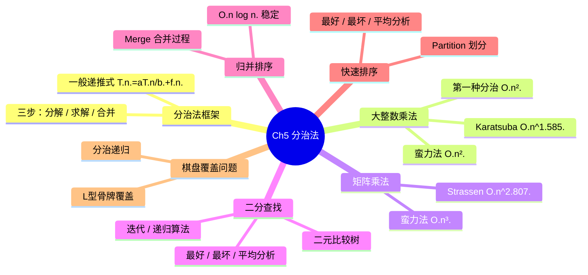

---

## 1️⃣ 分治法的思想与框架 (PPT P1-5)

> *分治法是算法设计中最核心的策略之一。它的思路朴素而强大：把一个"大问题"拆成若干"小问题"，分头解决后把结果拼回来。关键在于：子问题必须和原问题**结构相同**，只是**规模更小**。*

### 分治法的核心思想 (PPT P2-3)

分治法将原始问题（N 个输入）递归地分解为 **k 个子问题**，这些子问题满足三个条件：

1. **相同类型**：子问题与原问题的结构完全一致
2. **独立**：子问题之间互不依赖，可以各自求解
3. **规模均衡**：子问题的规模大致相等（这样效率最优）

当子问题小到**不用再分**就能直接求解时，递归触底；然后逐层向上**合并**子问题的解，最终得到原始问题的解。

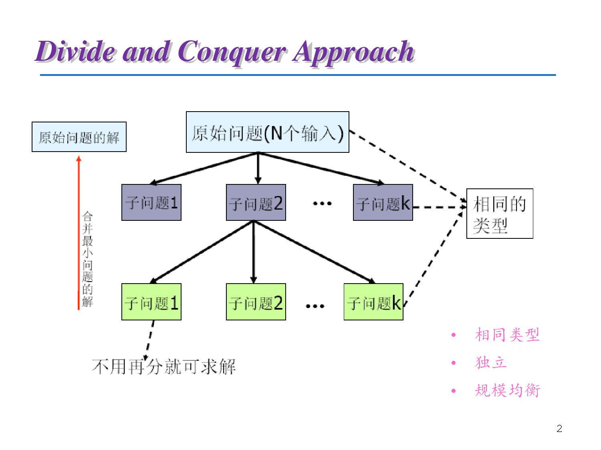

上图展示了分治法的递归分解过程：原始问题被拆分成 k 个子问题，每个子问题又继续拆分，直到不可再分为止。然后从底向上合并各层子问题的解。

### 三步框架 (PPT P4)

分治法的每一层递归都遵循**三个步骤**：

| 步骤 | 英文 | 含义 |
|:---:|:---:|------|
| **分解** | Divide | 将问题拆分为两个或更多**规模更小**的子问题 |
| **求解** | Conquer | **递归地**求解每个子问题 |
| **合并** | Combine | 将子问题的解**合并**成原问题的解 |

> ⚠️ 注意"合并"这一步的存在——它是分治法区别于普通递归的关键。有些算法（如快速排序）的"合并"开销为零，但"分解"开销大；有些算法（如归并排序）则相反。

### 一般递推公式 (PPT P5)

分治法的时间效率满足如下递推关系：

$$T(n) = \begin{cases} O(1) & n = 1 \\ aT(n/b) + f(n) & n > 1 \end{cases}$$

其中：
- **a**：子问题的个数
- **n/b**：每个子问题的规模（**假设 n 是 b 的幂**）
- **f(n)**：分解问题 + 合并解的时间开销

> *这个递推公式正是 [Ch4 主定理](../课件/+Chapt4E%20Recursive%20.pdf#page=13) 的应用场景。后续每个案例的效率分析都会用到主定理来"查表"得出复杂度。*

---

## 2️⃣ 大整数乘法 Multiplication of Large Integers (PPT P6-11)

> *这一节用"大整数乘法"这个问题来展示分治法的威力：蛮力法需要 $O(n^2)$ 次个位数乘法，而通过巧妙的分治策略（Karatsuba 算法）可以降到 $O(n^{1.585})$。这是分治法"减少子问题个数"思想的经典体现。*

### 2.1 问题描述与蛮力法 (PPT P6)

**问题**：给定两个 n 位大整数（用数组存储每一位），计算它们的乘积。

例如：$A = 1234567890135798642$ 和 $B = 8765432128482091283$

**蛮力法**：就是小学学的竖式乘法——用 B 的每一位去乘 A 的每一位，然后错位相加。

- 每一位乘每一位：$n \times n = n^2$ 次**个位数乘法**
- **效率**：$\Theta(n^2)$

### 2.2 第一种分治算法 (PPT P7-8)

**思路**：把 n 位整数一分为二，拆成两个 n/2 位的"半截"。

$$X = A \cdot 10^{n/2} + B, \quad Y = C \cdot 10^{n/2} + D$$

其中 A、B、C、D 都是 n/2 位数。


展开乘法：

$$X \times Y = AC \cdot 10^n + (AD + BC) \cdot 10^{n/2} + BD$$

这需要 **4 次** n/2 位数的乘法（AC、AD、BC、BD），加上若干次加法和移位。

**递推关系**：

$$T(n) = \begin{cases} O(1) & n = 1 \\ 4T(n/2) + O(n) & n > 1 \end{cases}$$

> *$O(n)$ 是加法和移位的开销（对 n 位数做加法是线性的）。*

**求解**（用主定理）：$a = 4, b = 2, k = 1$，比较 $a$ vs $b^k$：$4 > 2^1 = 2$ → Case 3

$$T(n) = O(n^{\log_2 4}) = O(n^2)$$

> ⚠️ **没有改进！** 分成 4 个子问题，每个规模减半，但子问题数太多，合并不够便宜，结果和蛮力法一样。

### 2.3 Karatsuba 算法——第二种分治 (PPT P9-10)

**关键洞察**：能否把 4 次乘法减少到 **3 次**？

注意到：

$$(A + B) \times (C + D) = AC + AD + BC + BD$$

因此：

$$AD + BC = (A + B)(C + D) - AC - BD$$

这样我们只需要计算 **3 次乘法**：$AC$、$BD$、$(A+B)(C+D)$，代价是多做几次加减法（$O(n)$）。

$$X \times Y = AC \cdot 10^n + [(A+B)(C+D) - AC - BD] \cdot 10^{n/2} + BD$$

**新的递推关系**：

$$T(n) = \begin{cases} O(1) & n = 1 \\ 3T(n/2) + O(n) & n > 1 \end{cases}$$

**求解**（主定理）：$a = 3, b = 2, k = 1$，比较 $a$ vs $b^k$：$3 > 2^1 = 2$ → Case 3

$$T(n) = O(n^{\log_2 3}) \approx O(n^{1.585}) \quad \checkmark \text{ 有改进！}$$

> *从 $O(n^2)$ 降到 $O(n^{1.585})$，仅仅是通过**减少一次乘法**（4→3）实现的。这就是分治法的精髓：减少递归子问题的数量，即使增加一些额外的加减法开销，也能在渐近复杂度上获得本质提升。*

### 2.4 进一步的思考 (PPT P11)

课件提到了几个要点：

- 两种分治的复杂度都是 $O(n^{\log 3})$，但考虑到 $a+b$、$c+d$ 可能产生 $m+1$ 位的进位，实际选择第二种方案
- 如果把大整数分成**更多段**，用更复杂的组合方式，可以进一步优化 → 最终这一思路导致了**快速傅里叶变换（FFT）**的产生，也可看作更复杂的分治算法（Toom-Cook 算法）

---

## 3️⃣ 矩阵乘法与 Strassen 算法 (PPT P12-17)

> *矩阵乘法是分治法的另一个经典应用。思路和大整数乘法完全一样：先用分治把矩阵拆成子矩阵，发现子问题数太多导致没有改进，然后想办法**减少子问题数量**。Strassen 在 1969 年用同样的技巧将 8 次矩阵乘法减少到 7 次，打破了 $O(n^3)$ 的壁垒。*

### 3.1 蛮力法 (PPT P12)

两个 $n \times n$ 矩阵相乘，结果矩阵的每个元素：

$$C_{ij} = \sum_{k=1}^{n} A_{ik} B_{kj}$$

- 每个 $C_{ij}$ 需要 **n 次乘法** 和 **n-1 次加法**
- 共 $n^2$ 个元素
- **总复杂度**：$T(n) = O(n^3)$

### 3.2 分治 idea1——直接分块 (PPT P13)

把 A、B、C 各分成 4 个 $n/2 \times n/2$ 的子矩阵：

$$\begin{bmatrix} C_{11} & C_{12} \\ C_{21} & C_{22} \end{bmatrix} = \begin{bmatrix} A_{11} & A_{12} \\ A_{21} & A_{22} \end{bmatrix} \begin{bmatrix} B_{11} & B_{12} \\ B_{21} & B_{22} \end{bmatrix}$$

按分块乘法展开，需要 **8 次** $n/2$ 阶矩阵乘法 + 4 次矩阵加法：

$$T(n) = \begin{cases} O(1) & n = 1 \\ 8T(n/2) + O(n^2) & n > 1 \end{cases}$$

主定理：$a = 8, b = 2, k = 2$，$a = 8 > b^k = 4$ → Case 3 → $T(n) = O(n^{\log_2 8}) = O(n^3)$

> ⚠️ 和大整数乘法的第一次分治一样——**没有改进**。原因相同：8 个子问题太多了。

### 3.3 Strassen 算法——减少到 7 次乘法 (PPT P14)

Strassen（1969）发现，通过精心构造 **7 个辅助矩阵** $M_1 \sim M_7$，可以只用 **7 次**矩阵乘法（代价是更多的加减法）来计算 $C_{11}, C_{12}, C_{21}, C_{22}$：

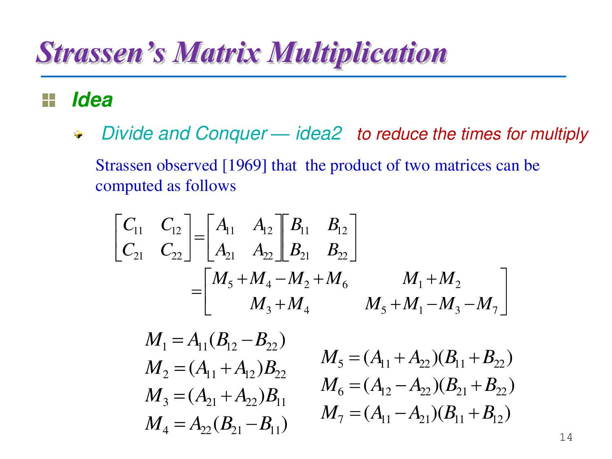

先定义 7 个辅助乘积（每个只需**一次**矩阵乘法）：

$$M_1 = A_{11}(B_{12} - B_{22}), \quad M_2 = (A_{11} + A_{12})B_{22}, \quad M_3 = (A_{21} + A_{22})B_{11}$$

$$M_4 = A_{22}(B_{21} - B_{11}), \quad M_5 = (A_{11} + A_{22})(B_{11} + B_{22})$$

$$M_6 = (A_{12} - A_{22})(B_{21} + B_{22}), \quad M_7 = (A_{11} - A_{21})(B_{11} + B_{12})$$

然后用加减法组合得到结果矩阵的 4 个子块：

$$C_{11} = M_5 + M_4 - M_2 + M_6, \quad C_{12} = M_1 + M_2$$

$$C_{21} = M_3 + M_4, \quad C_{22} = M_5 + M_1 - M_3 - M_7$$

> *关键在于：7 次矩阵乘法 + 18 次矩阵加减法，替代了原来的 8 次乘法 + 4 次加法。乘法次数减少 1 次看似微小，但递归下去后渐近复杂度从 $n^3$ 降到了 $n^{2.807}$——和大整数乘法中"4次→3次"的思路一模一样。*

### 3.4 Strassen 效率分析 (PPT P15)

**递推关系**：

$$M(n) = 7M(n/2), \quad M(1) = 1$$

**求解**：

$$M(n) = 7^{\log_2 n} = n^{\log_2 7} \approx n^{2.807}$$

相比蛮力法的 $n^3$，这是一个本质性的改进。

**实际使用注意**：
- 当 n 不是 2 的幂时，可以用零填充（padding）
- 实际实现中，当矩阵规模小到某个"交叉点"（crossover point）时，会切换回蛮力法，因为 Strassen 的常数因子较大

### 3.5 实际性能对比 (PPT P16)

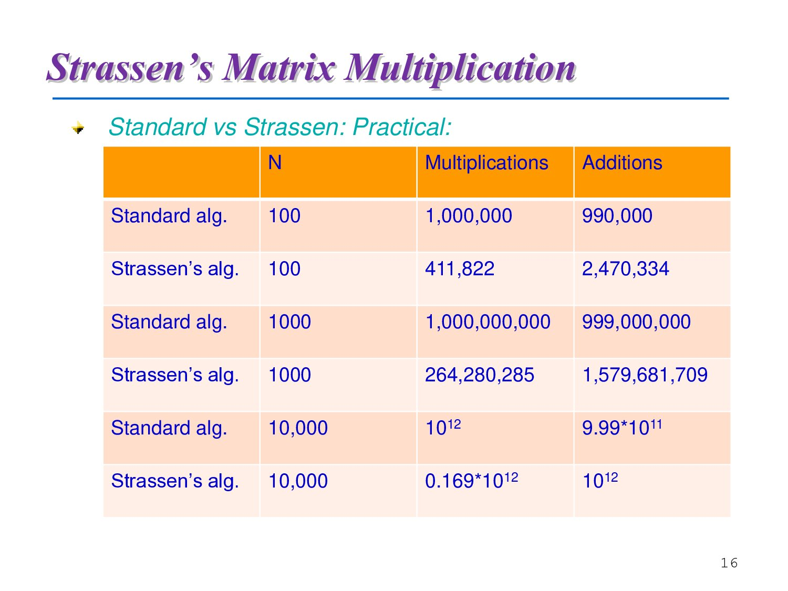

从表中可以看到：
- N=100 时，Strassen 的乘法次数约为标准算法的 41%
- N=1000 时，降到约 26%
- N=10000 时，降到约 17%
- 但 **加法次数更多**——Strassen 用加法换乘法

### 3.6 更优算法一览 (PPT P17)

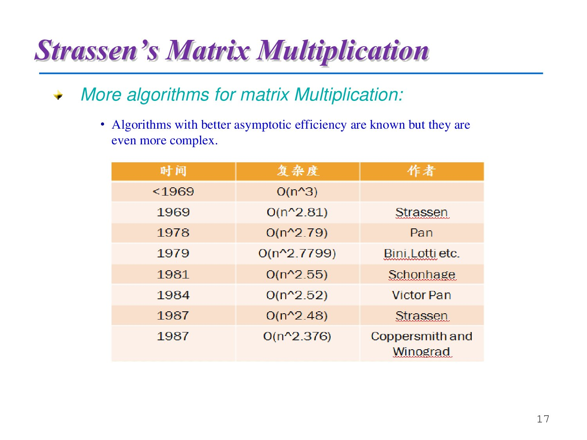

从 1969 年 Strassen 的 $O(n^{2.81})$ 开始，研究者们不断刷新矩阵乘法的复杂度下界。到 1987 年已经达到 $O(n^{2.376})$。但这些更优算法通常更复杂，实际应用中很少使用。

---

## 4️⃣ 二分查找 Binary Search (PPT P18-28)

> *二分查找是分治法最简单的应用之一——每次将搜索范围**减半**，只需 $O(\log n)$ 次比较就能在有序数组中定位元素。本节覆盖迭代/递归两种实现、最好/最坏/平均三种分析，以及用二元比较树（Binary Comparison Tree）来可视化搜索过程。*

### 4.1 问题描述与思路 (PPT P18)

**问题**：已知一个**非递减排序**的数组 $A[0], A[1], \ldots, A[n-1]$，判断给定元素 K 是否在数组中。若在，返回其下标；若不在，返回 -1。

**分治思路**：选取中间元素 $A[m]$（$m = \lfloor(l+r)/2\rfloor$），将问题分成三个子问题：

| 子问题 | 条件 | 含义 |
|:---:|:---:|------|
| $I_1 = (m, a_0, \ldots, a_{m-1}, K)$ | $K < A[m]$ | 在**左半部分**继续搜索 |
| $I_2 = (1, a_m, K)$ | $K = A[m]$ | **找到了**，直接返回 |
| $I_3 = (n-m-1, a_{m+1}, \ldots, a_{n-1}, K)$ | $K > A[m]$ | 在**右半部分**继续搜索 |

> *当所选的下标 m 都是中间元素的下标时，$m = \lfloor(l+r)/2\rfloor$，这就是标准的**二分检索算法**。*

### 4.2 示例 (PPT P19-20)

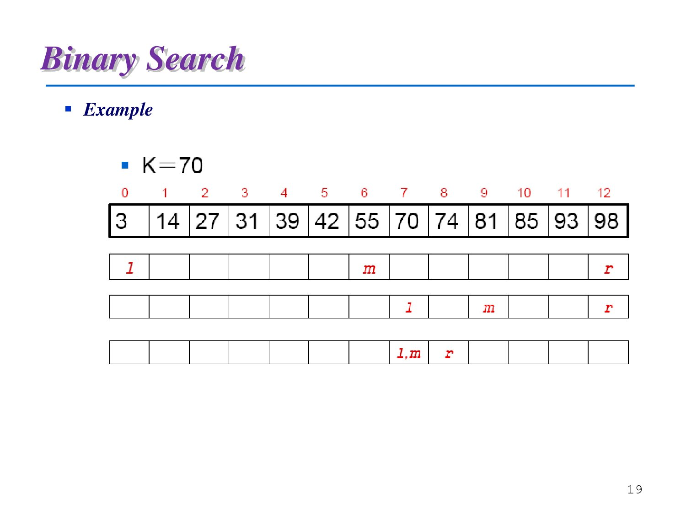

上图演示了在数组 `[3, 14, 27, 31, 39, 42, 55, 70, 74, 81, 85, 93, 98]` 中查找 K=70 的过程：
- 第一轮：$l=0, r=12, m=6$，$A[6]=55 < 70$，去右半部分
- 第二轮：$l=7, r=12, m=9$，$A[9]=81 > 70$，去左半部分
- 第三轮：$l=7, r=8, m=7$，$A[7]=70 = K$，找到！

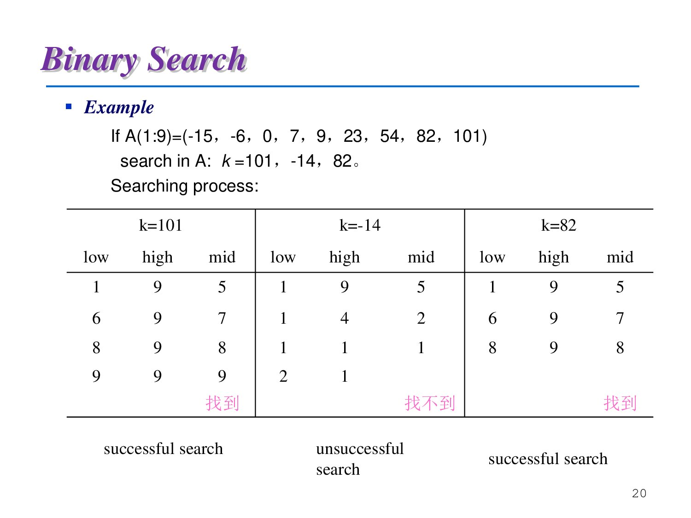

PPT P20 展示了三个查找过程：K=101（成功）、K=-14（失败）、K=82（成功），可以看到每次搜索的 low/high/mid 变化。

### 4.3 迭代算法 (PPT P21)

```
Algorithm BinarySearch(A[0..n-1], K)
// 在非递减有序数组 A 中查找 K
l ← 0;  r ← n-1
while l ≤ r do
    m ← ⌊(l+r)/2⌋
    if K = A[m]  return m        // 找到
    else if K < A[m]  r ← m-1   // 去左半部分
    else  l ← m+1               // 去右半部分
return -1                        // 没找到
```

**核心逻辑**：维护搜索区间 $[l, r]$，每次取中间位置 m 比较。如果 $K = A[m]$ 就返回；否则根据大小关系将区间缩小一半。当 $l > r$ 时区间为空，搜索失败。

### 4.4 递归算法 (PPT P22)

```
Algorithm BinarySearchRecur(A[0..n-1], l, r, K)
if l > r
    return -1                           // 区间为空，搜索失败
else
    m ← ⌊(l + r) / 2⌋
    if K = A[m]
        return m                        // 找到
    else if K < A[m]
        return BinarySearchRecur(A[0..n-1], l, m-1, K)   // 搜左半
    else
        return BinarySearchRecur(A[0..n-1], m+1, r, K)   // 搜右半
```

> *递归版本和迭代版本的逻辑完全一致，只是用递归调用替代了 while 循环。基本操作是**三路比较**（three-way comparison）：先判断相等，再判断大小。*

### 4.5 效率分析 (PPT P23-25)

**基本操作**：关键比较（三路比较，three-way comparison）

#### 最坏情况（PPT P23）

对于 $n = 2^k$：

$$C_w(n) = C_w(\lfloor n/2 \rfloor) + 1, \quad C_w(1) = 1$$

反向替换：$C(2^k) = C(2^{k-1}) + 1 = C(2^{k-2}) + 2 = \cdots = C(2^0) + k = 1 + k$

$$\boxed{C_w(n) = \log_2 n + 1 = \Theta(\log n)}$$

#### 最好情况

- **成功查找**：$C_b(n) = 1$（一次就找到，即 $K = A[n/2]$）

#### 平均情况（PPT P24, P28）

用**二元比较树**来分析平均查找次数。

### 4.6 二元比较树 Binary Comparison Tree (PPT P24, P26-27)

> *二元比较树是一种可视化二分查找过程的工具。树的每个节点代表一次比较操作，从根到某个节点的路径长度就是查找该元素所需的比较次数。*

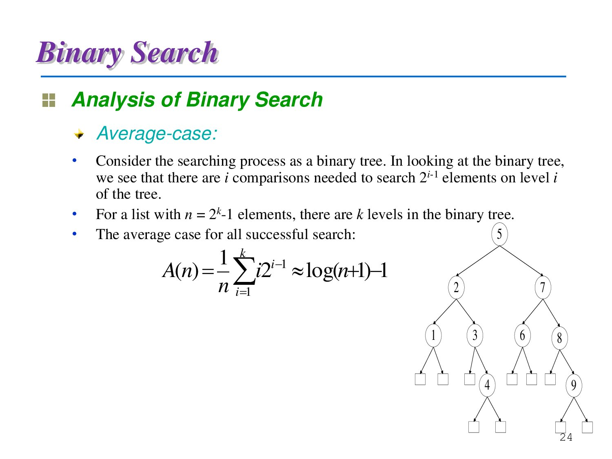

**树的结构**：

- **内结点（圆形）**：代表一次元素比较，存放中间元素的下标 mid
  - 用圆形结点表示
  - 代表**成功查找**的情况
- **外结点（方形）**：代表搜索失败
  - 用方形结点表示
  - 代表**不成功查找**的情况
- **路径**：代表检索中元素的比较序列

**分析查找次数**（PPT P25-27）：

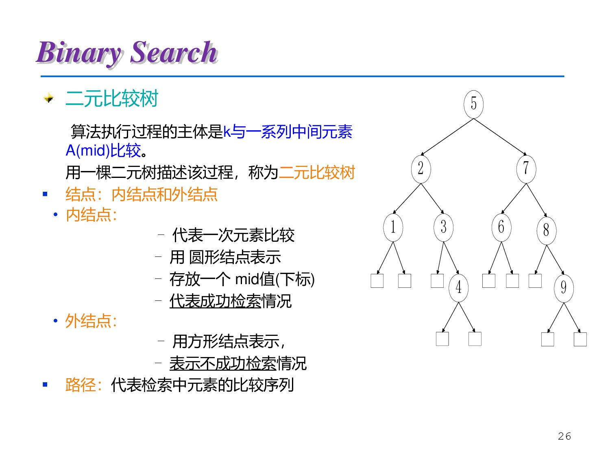

以上图中 9 个元素（下标 1~9）的二元比较树为例来理解：
- **根节点 ⑤**：第一次比较 $K$ 与 $A[5]$。如果 $K = A[5]$，找到了（1 次比较）
- **第二层 ②⑦**：如果 $K < A[5]$ 就走左子树到 ②，否则走右子树到 ⑦（2 次比较）
- **第三层 ①③⑥⑧**：继续二分（3 次比较）
- **第四层 ④⑨**：再继续（4 次比较）
- **方形外结点 □**：走到这里意味着搜索区间为空，**查找失败**

注意看：树不一定是满二叉树（④ 和 ⑨ 在第四层，而其他元素在更高层）。查找不同元素需要的比较次数不同，这正是"平均情况分析"的意义所在。

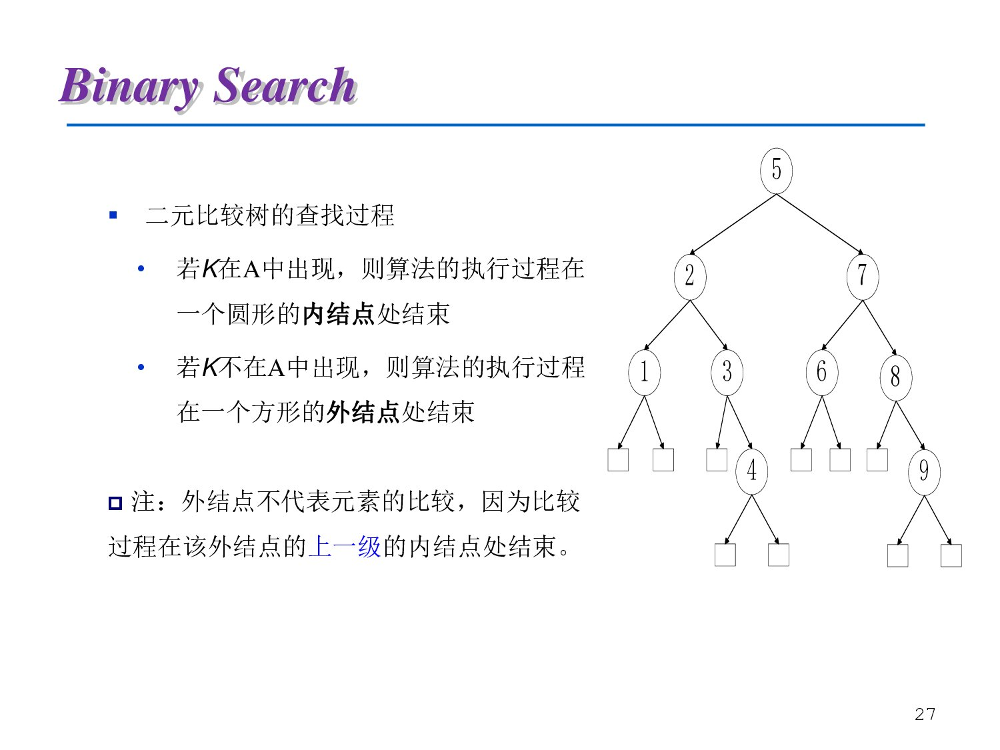

上图说明了：
- 若 K 在 A 中出现，算法执行过程终止在某个**内结点**
- 若 K 不在 A 中，算法执行过程终止在某个**外结点**处（注意：外结点不代表比较，比较在其上一级的内结点处结束）

#### 平均查找复杂度（PPT P28）

对于 $n = 2^k - 1$ 个元素的满二叉比较树，平均成功查找次数：

$$A(n) = \frac{1}{n} \sum_{i=1}^{k} i \cdot 2^{i-1} \approx \log(n+1) - 1$$

**逐个查找的平均复杂度**（PPT P28 的一般公式）：

$$T_{avg}(n) = \sum_{size(I)=n} p(I) \cdot T(I) = \left(1 \cdot \frac{p}{n} + 2 \cdot \frac{p}{n} + \cdots + n \cdot \frac{p}{n}\right) + n \cdot (1-p)$$

$$= \frac{p}{n} \sum_{i=1}^{n} i + n(1-p) = \frac{p(n+1)}{2} + n(1-p)$$

其中 $p$ 是 K 在数组中的概率。

---

## 5️⃣ 归并排序 Mergesort (PPT P29-35)

> *归并排序是分治法在排序问题上的标准应用。它的特点是：**"分"很简单（直接取中间切一刀），"合"比较费劲（需要 $O(n)$ 的 Merge 操作）**。无论最好、最坏、平均情况，时间复杂度都是 $\Theta(n \log n)$，是一种稳定的排序算法。*

### 5.1 分治思路 (PPT P29-30)

归并排序的三步：

1. **Divide**：把数组 $A[\text{first}..\text{last}]$ 从中间位置 $\lfloor(\text{first}+\text{last})/2\rfloor$ 一分为二
2. **Conquer**：递归地对左半和右半分别排序
3. **Combine**：将两个已排序的子数组**合并（Merge）**成一个有序数组

下图展示了这一流程——先切分，递归排好左右两半，最后用 Merge 合并：

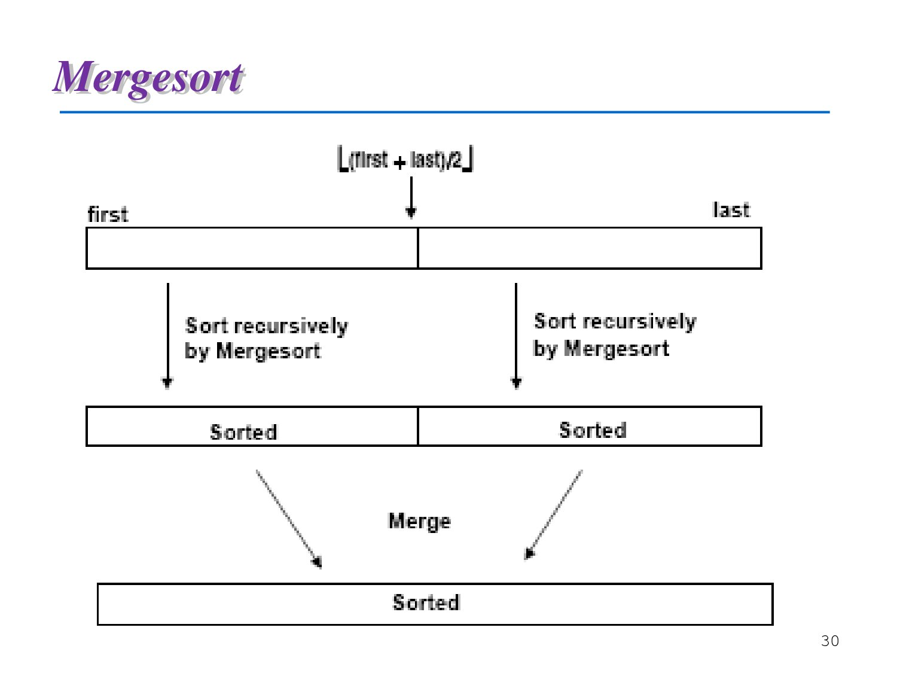

### 5.2 Merge 合并操作 (PPT P31, P33)

Merge 是归并排序的核心。它的任务是：给定两个**已排序**的数组 B 和 C，将它们合并成一个有序数组 A。

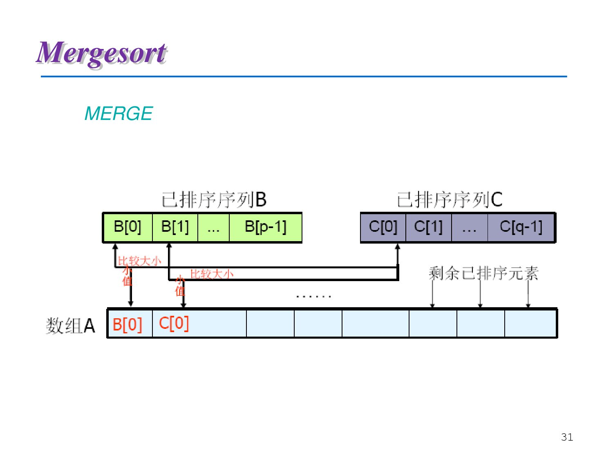

上图展示了 Merge 的工作方式：
- B 数组有 p 个元素（已排序），C 数组有 q 个元素（已排序）
- 用两个指针 i、j 分别指向 B 和 C 的当前位置
- 每次**比较** B[i] 和 C[j]，将较小者放入结果数组 A[k]，对应指针前进
- 当某一个数组的元素全部放完后，把另一个数组的**剩余元素直接拷贝**到 A 的末尾

**Merge 算法伪代码**（PPT P33）：

```
Algorithm Merge(B[0..p-1], C[0..q-1], A[0..p+q-1])
// 将两个已排序数组 B 和 C 合并到 A
i ← 0;  j ← 0;  k ← 0
while i < p and j < q do
    if B[i] ≤ C[j]
        A[k] ← B[i];  i ← i + 1
    else
        A[k] ← C[j];  j ← j + 1
    k ← k + 1
if i = p                         // B 已用完
    copy C[j..q-1] to A[k..p+q-1]
else                              // C 已用完
    copy B[i..p-1] to A[k..p+q-1]
```

**Merge 的关键比较次数**：$C_{\text{merge}}(n) = n - 1$（最坏情况下每个元素都需要比较一次，最后一个元素直接放入）。

### 5.3 示例：`8 3 2 9 7 1 5 4` (PPT P34)

下图展示了归并排序的完整递归过程——上半部分是"分"（向下箭头），下半部分是"合"（向上箭头）：

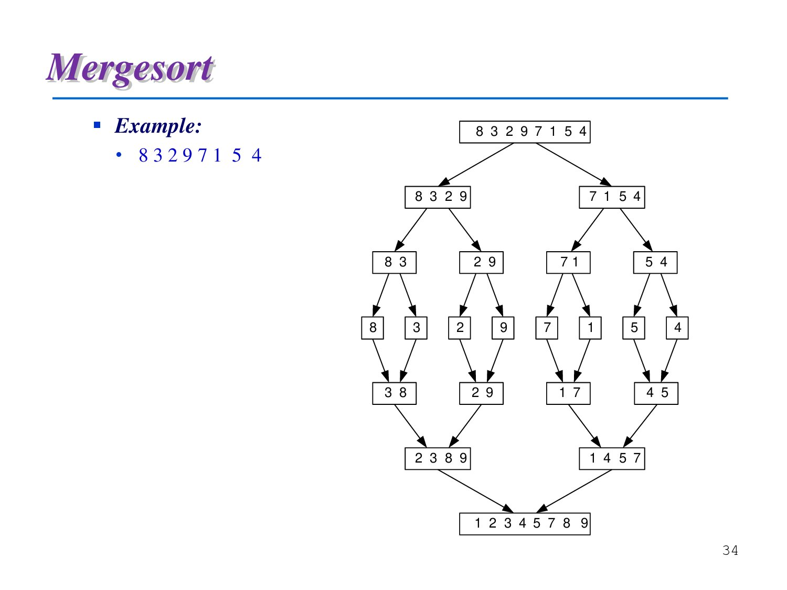

逐层解读：
- **分解阶段**（从上往下看）：`8 3 2 9 7 1 5 4` → 分成 `8 3 2 9` 和 `7 1 5 4` → 继续分成 `8 3`、`2 9`、`7 1`、`5 4` → 最终分成单个元素 `8`、`3`、`2`、`9`、`7`、`1`、`5`、`4`
- **合并阶段**（从下往上看）：单个元素天然有序 → 两两 Merge 得到 `3 8`、`2 9`、`1 7`、`4 5` → 再 Merge 得到 `2 3 8 9`、`1 4 5 7` → 最终 Merge 得到 `1 2 3 4 5 7 8 9`

### 5.4 效率分析 (PPT P35)

**基本操作**：关键比较（key comparisons）

$$C(n) = 2C(n/2) + C_{\text{merge}}(n), \quad C(1) = 0$$

其中 $C_{\text{merge}}(n) = n - 1$，所以：

$$C(n) = 2C(n/2) + (n-1)$$

用主定理：$a = 2, b = 2, f(n) = n-1 = \Theta(n)$，$a = b^k = 2$ → Case 2

$$\boxed{C(n) = \Theta(n \log n)}$$

> *归并排序的优点：无论输入数据如何分布，时间复杂度始终是 $\Theta(n \log n)$，它的键值比较次数非常接近理论下界 $n \log_2 n - n + 1$。缺点：需要 $O(n)$ 的额外存储空间来完成 Merge 操作。*

---

## 6️⃣ 快速排序 Quicksort (PPT P36-48)

> *快速排序和归并排序正好相反：**"分"很费劲（需要 Partition 操作），"合"不用做**。它在平均情况下是 $O(n \log n)$ 的，实际性能通常比归并排序更好（常数因子更小），但最坏情况退化为 $O(n^2)$。*

### 6.1 分治思路 (PPT P36)

快速排序的三步：

1. **Divide（Partition）**：选取一个**划分元素（pivot）** p，将数组 $A[l..r]$ 重排为两个子数组——左边的元素都 $\leq p$，右边的元素都 $\geq p$。划分完成后，p 已经在它**最终排序的位置**上
2. **Conquer**：递归地对左子数组 $A[l..s-1]$ 和右子数组 $A[s+1..r]$ 进行快速排序
3. **Combine**：**不需要任何操作**——因为 Partition 之后，左边都比 p 小，右边都比 p 大，p 在中间，整个数组自然有序

> *对比归并排序：归并排序的 Divide 是简单的取中间切分（$O(1)$），Combine 是 $O(n)$ 的 Merge；快速排序的 Divide 是 $O(n)$ 的 Partition，Combine 是 $O(1)$（什么都不做）。工作量的分布正好颠倒。*

### 6.2 Partition 过程详解 (PPT P37-40)

Partition 是快速排序的核心操作。PPT P37 用下图展示了其工作目标：

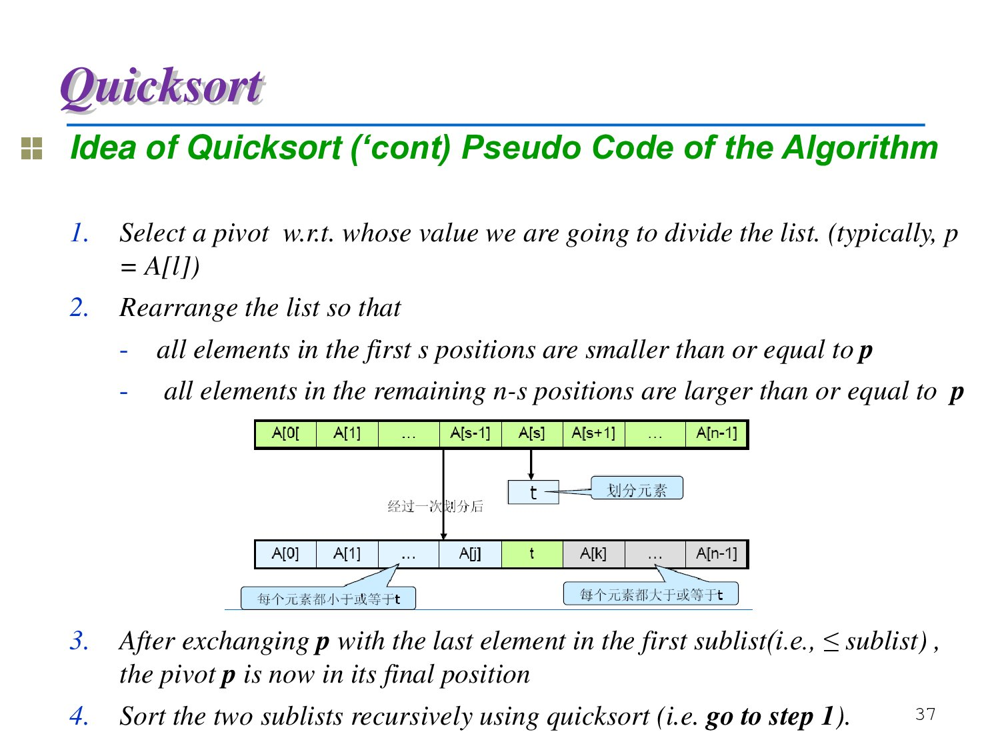

具体步骤如下：
1. 选取 pivot $p = A[l]$（取数组第一个元素作为划分基准）
2. 将数组重排，使得前 s 个位置的元素都 $\leq p$，后 $n-s$ 个位置的元素都 $\geq p$
3. 将 p 与 ≤ 子表的最后一个元素交换，此时 **p 就在最终位置上**（位置 s）
4. 递归地对两个子表执行 quicksort

#### 双指针扫描实现 (PPT P39)

Partition 的实际实现基于**双向扫描**：

- **左扫指针 i**（从第二个元素开始，向右移动）：跳过所有 $< p$ 的元素，在遇到第一个 $\geq p$ 的元素时**停下**
- **右扫指针 j**（从最后一个元素开始，向左移动）：跳过所有 $> p$ 的元素，在遇到第一个 $\leq p$ 的元素时**停下**

当两个指针都停下时，如果 $i < j$，就**交换** $A[i]$ 和 $A[j]$，然后继续扫描。

#### 扫描停止的三种情况 (PPT P40)

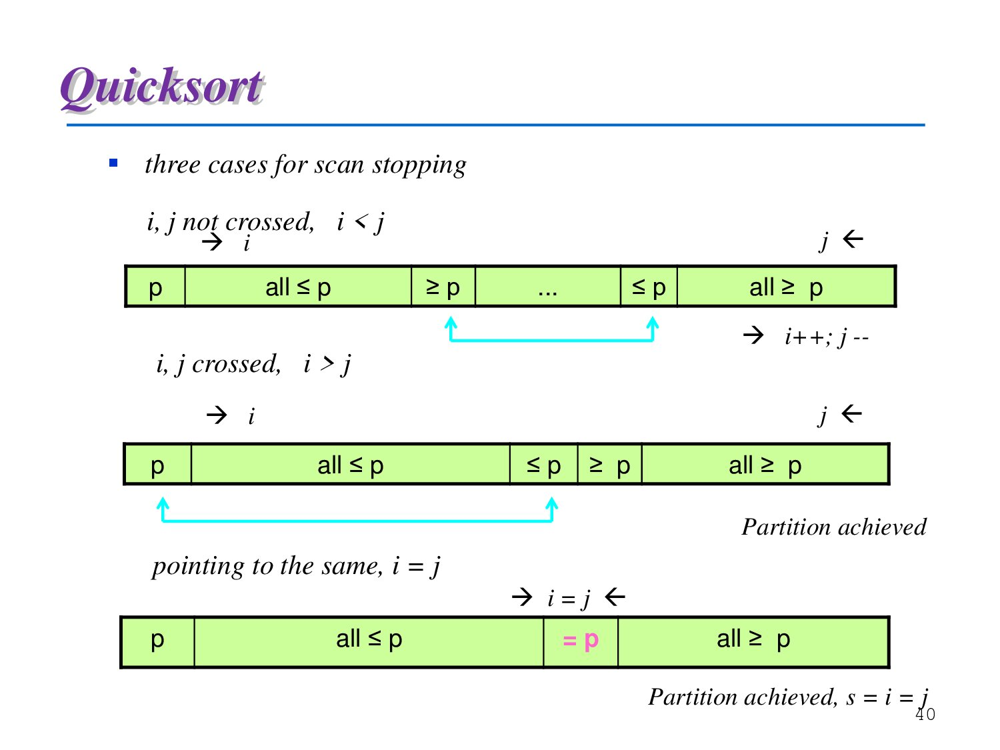

上图展示了 i、j 停止时的三种情况：

**情况 1：i, j 未交叉（$i < j$）**
- i 停在一个 $\geq p$ 的元素上，j 停在一个 $\leq p$ 的元素上
- **交换** $A[i]$ 和 $A[j]$，然后 $i$++、$j$--，继续扫描

**情况 2：i, j 交叉（$i > j$）**
- 此时左侧（$A[l+1..j]$）全部 $\leq p$，右侧（$A[i..r]$）全部 $\geq p$
- **Partition 完成**，将 pivot $A[l]$ 与 $A[j]$ 交换，返回 $s = j$

**情况 3：i = j**
- 两个指针指向同一个元素，该元素恰好等于 p
- **Partition 完成**，$s = i = j$

### 6.3 示例 (PPT P43)

下面用 PPT P43 的例子详细追踪一次 Partition 的执行过程：

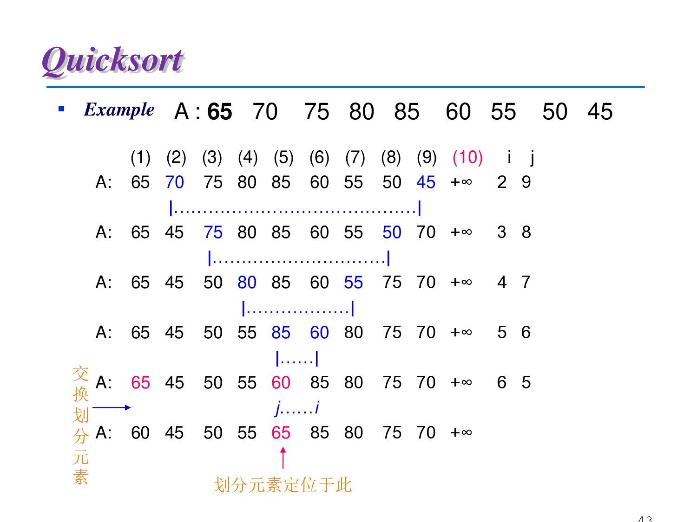

数组 A = `65, 70, 75, 80, 85, 60, 55, 50, 45`，pivot $p = A[1] = 65$，位置 (10) 放 $+\infty$ 作为哨兵。

逐步追踪：
- **初始**：$i=2, j=9$。i 从位置 2 开始右扫，$A[2]=70 \geq 65$，停下；j 从位置 9 开始左扫，$A[9]=45 \leq 65$，停下。$i < j$，交换 $A[2]$ 和 $A[9]$
- **第二轮**：$i=3, j=8$。$A[3]=75 \geq 65$，i 停；$A[8]=50 \leq 65$，j 停。交换
- **第三轮**：$i=4, j=7$。$A[4]=80 \geq 65$，i 停；$A[7]=55 \leq 65$，j 停。交换
- **第四轮**：$i=5, j=6$。$A[5]=85 \geq 65$，i 停；$A[6]=60 \leq 65$，j 停。交换
- **第五轮**：$i=6, j=5$。此时 $i > j$，**交叉**！→ Partition 完成
- **最后**：将 pivot $A[1]=65$ 与 $A[j]=A[5]=60$ 交换 → 最终数组 `60, 45, 50, 55, **65**, 85, 80, 75, 70`，65 定位于位置 (6)

### 6.4 算法伪代码 (PPT P41-42)

**Quicksort 主算法**（PPT P41）：

```
Algorithm Quicksort(A[l..r])
// 对子数组 A[l..r] 进行快速排序
if l < r
    s ← Partition(A[l..r])    // s 是划分点
    Quicksort(A[l..s-1])      // 递归排序左半
    Quicksort(A[s+1..r])      // 递归排序右半
```

**Partition 代码**（PPT P42，C++ 风格）：

```cpp
template<class Type>
int Partition(Type a[], int l, int r) {
    int i = l, j = r + 1;
    Type x = a[l];              // pivot = 第一个元素
    // 将 < x 的元素交换到左边区域
    // 将 > x 的元素交换到右边区域
    while (true) {
        while (a[++i] < x);     // 左扫：跳过 < pivot 的
        while (a[--j] > x);     // 右扫：跳过 > pivot 的
        if (i >= j) break;      // 交叉则退出
        Swap(a[i], a[j]);       // 未交叉则交换
    }
    // 将 pivot 交换到它应在的最终位置
    a[l] = a[j];
    a[j] = x;
    return j;                   // 返回划分点位置
}
```

**代码要点**：
- `i` 初始化为 `l`（而非 `l+1`），因为循环里用的是 `++i`（先加再访问）
- `j` 初始化为 `r+1`，因为循环里用的是 `--j`（先减再访问）
- 需要设置**哨兵**（在数组末尾放一个 $+\infty$）来防止 i 越界

**Partition 的比较次数**（PPT P42 右下角）：
- 若 i, j **交叉**（$i > j$）：$n + 1$ 次比较
- 若 i, j **重合**（$i = j$）：$n$ 次比较

### 6.5 效率分析 (PPT P44-47)

**基本操作**：关键比较（key comparison）。效率取决于 **Partition 是否均衡**。

#### 最好情况：均匀划分 (PPT P45)

每次 pivot 恰好将数组分成**大小相等的两半**：

$$C_b(n) = 2C_b(n/2) + \Theta(n), \quad C_b(1) = 0$$

主定理：$a=2, b=2, f(n)=\Theta(n)$ → Case 2 → $\boxed{C_b(n) = \Theta(n \log n)}$

#### 最坏情况：已排序数组 (PPT P46)

当数组**已经有序**（或逆序），且 pivot 选第一个元素时，每次 Partition 产生一个规模为 0 的子问题和一个规模为 $n-1$ 的子问题——完全不均衡：

$$C_w(n) = C_w(n-1) + \Theta(n), \quad C_w(1) = 0$$

以 $A[0..n-1]$ 严格递增为例：pivot = $A[0]$ 是最小值，左扫指针 i 一路扫到 $A[1]$ 就停了（$A[1] \geq A[0]$），右扫指针 j 从 $A[n-1]$ 一路扫到 $A[0]$ 才停。每次 Partition 需要 $n+1$ 次比较，但只排除了一个元素。

$$C_w(n) = (n+1) + n + \cdots + 3 = \frac{(n+1)(n+2)}{2} - 3 = \boxed{\Theta(n^2)}$$

#### 平均情况 (PPT P47)

对于**随机数组**：$C_{avg}(n) = O(n \log n)$

### 6.6 改进策略 (PPT P48)

快速排序的性能瓶颈在于 Partition 的对称性——如果每次都选到最大或最小元素做 pivot，就会退化成 $O(n^2)$。改进方法：

**随机化 Partition**：不固定选 $A[l]$ 做 pivot，而是在 $A[l..r]$ 中**随机选一个元素**作为 pivot，然后与 $A[l]$ 交换后执行标准 Partition。

```cpp
template<class Type>
int RandomizedPartition(Type a[], int p, int r) {
    int i = Random(p, r);       // 在 [p, r] 中随机选一个
    Swap(a[i], a[p]);           // 与第一个元素交换
    return Partition(a, p, r);  // 执行标准 Partition
}
```

> *随机化的目的是让 pivot 的选取"期望上"均匀，从而使划分大概率接近对称，避免最坏情况。这样，即使输入数据已排序，期望时间复杂度仍然是 $O(n \log n)$。*

---

## 7️⃣ 棋盘覆盖问题 Chessboard Cover (PPT P49-60)

> *棋盘覆盖是分治法在几何/组合问题上的一个应用。问题本身很直观：在一个有一个方格被占据的棋盘上，用 L 形骨牌覆盖其余所有方格。分治法通过递归地"四等分 + 中心放一块骨牌"来优雅地解决。*

### 7.1 问题描述 (PPT P49)

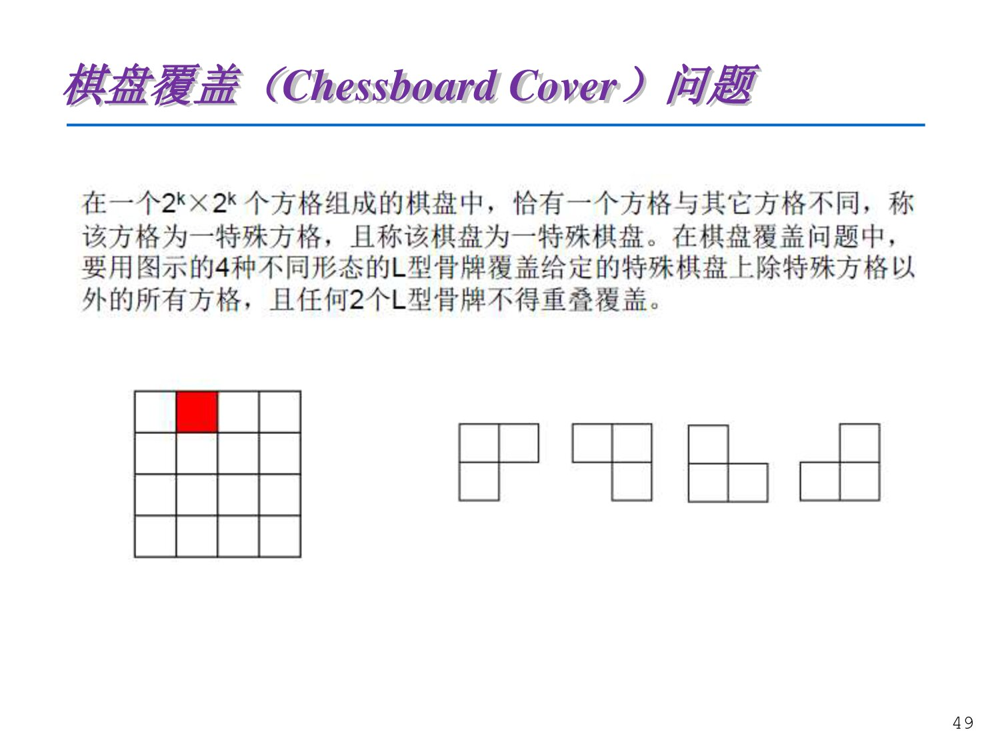

**问题定义**：
- 棋盘大小为 $2^k \times 2^k$ 个方格
- 其中**恰好一个方格**是特殊的（红色方格），称为"特殊方格"
- 要求：用 **4 种不同形态的 L 型骨牌**（每块覆盖 3 个方格）覆盖棋盘上除特殊方格以外的所有方格
- 约束：任何**两块 L 型骨牌不得重叠**

### 7.2 分治策略 (PPT P50)

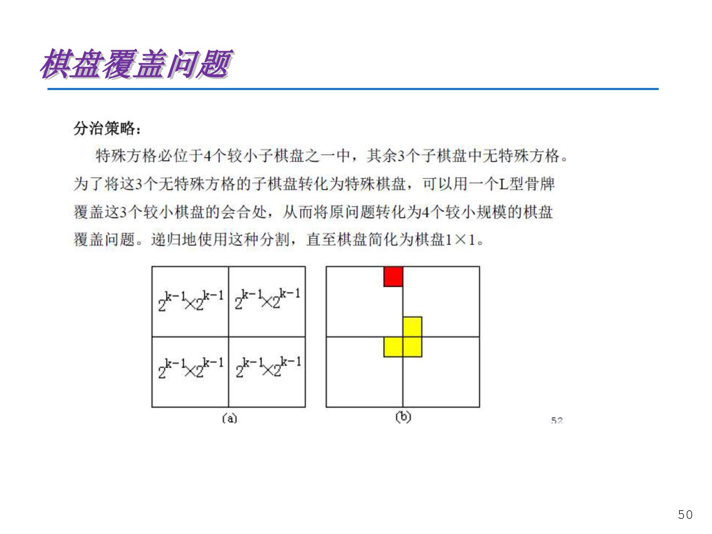

分治的关键思路：

1. **Divide**：将 $2^k \times 2^k$ 棋盘**四等分**为 4 个 $2^{k-1} \times 2^{k-1}$ 的子棋盘
2. 特殊方格必然落在 4 个子棋盘中的**某一个**。其余 3 个子棋盘中没有特殊方格
3. **关键技巧**：在这 3 个无特殊方格的子棋盘的**交汇处**放一块 L 型骨牌（图中黄色方格），使每个子棋盘都恰好有一个"被占据"的方格 → 这样 4 个子棋盘的结构完全统一了
4. **Conquer**：递归地对 4 个子棋盘分别求解
5. **基准情况**：当棋盘为 $1 \times 1$ 时，不需要放骨牌（因为那个方格就是特殊方格）

### 7.3 分割过程演示 (PPT P51-55)

PPT 用一个 $2^4 \times 2^4 = 16 \times 16$ 的棋盘演示了分割过程。下面依次展示前三次分割：

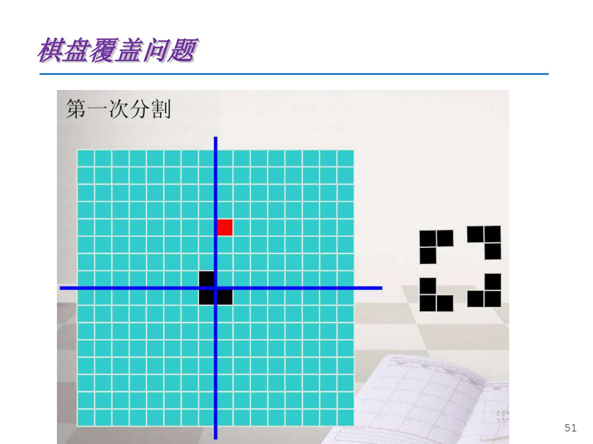

**第一次分割**：将 $16 \times 16$ 棋盘分成 4 个 $8 \times 8$ 子棋盘。红色特殊方格在右上角子棋盘中，在其余 3 个子棋盘的交汇角各放一个方格（组成一个 L 型骨牌），使 4 个子棋盘都有一个"被占据"的方格。

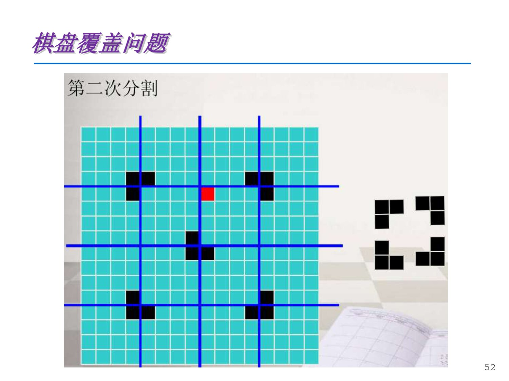

**第二次分割**：对每个 $8 \times 8$ 子棋盘重复上述操作 → 分成 $4 \times 4$ 的子棋盘。

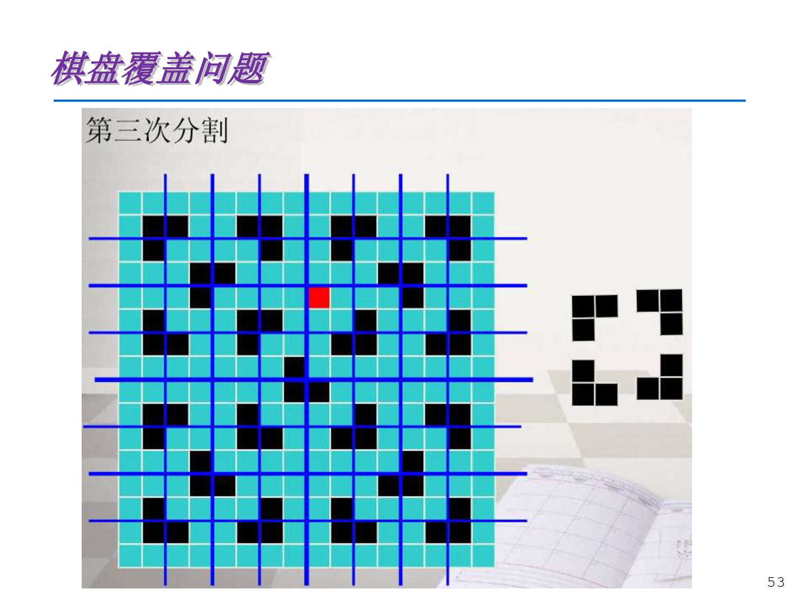

**第三次分割**：继续分割为 $2 \times 2$ 的子棋盘。

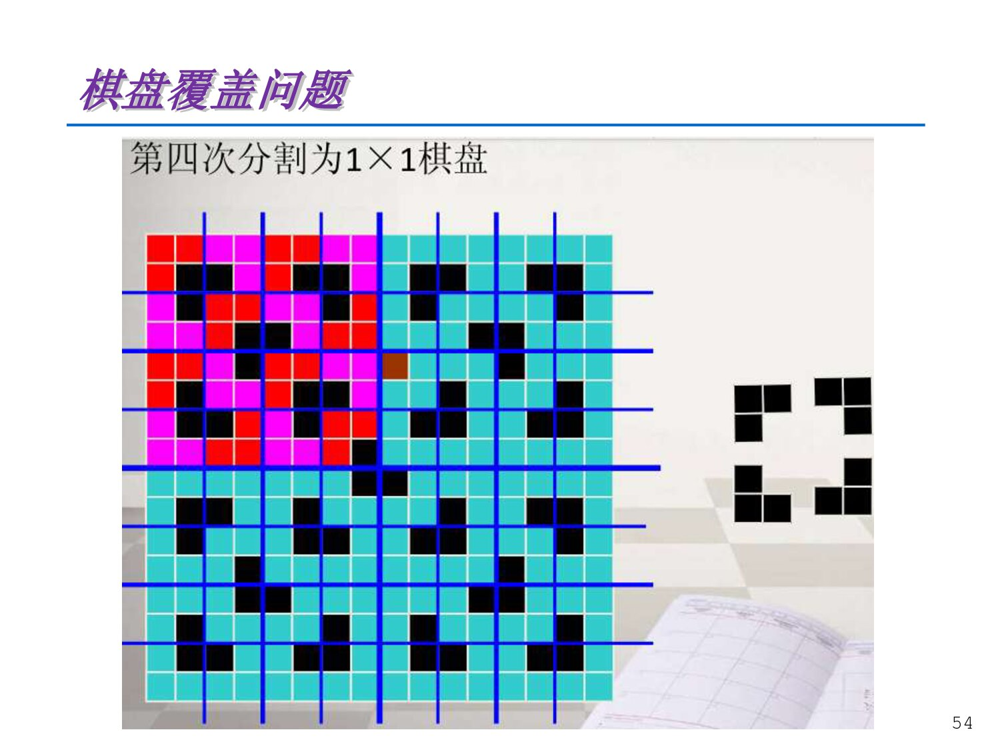

**第四次分割**：分割到 $1 \times 1$ 棋盘，递归触底。此时所有骨牌已放置完毕。

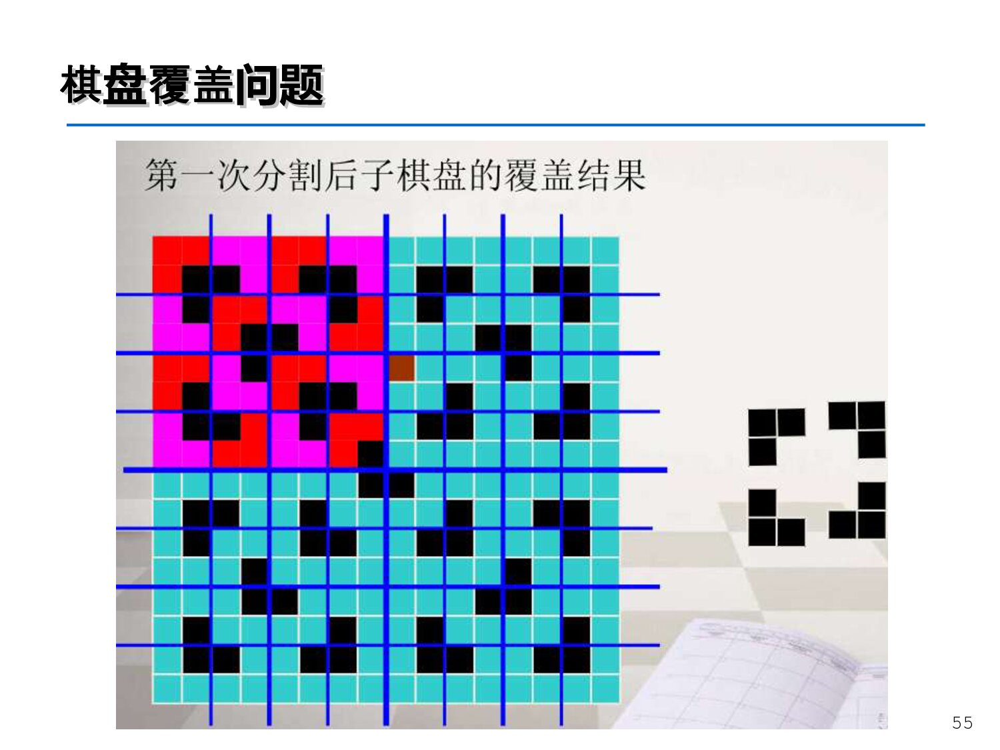

上图展示了第一次分割后各子棋盘独立覆盖的最终结果（用不同颜色表示不同骨牌编号），可以看到每个子棋盘的覆盖方案是独立完成的。

### 7.4 数据结构与参数 (PPT P56-57)

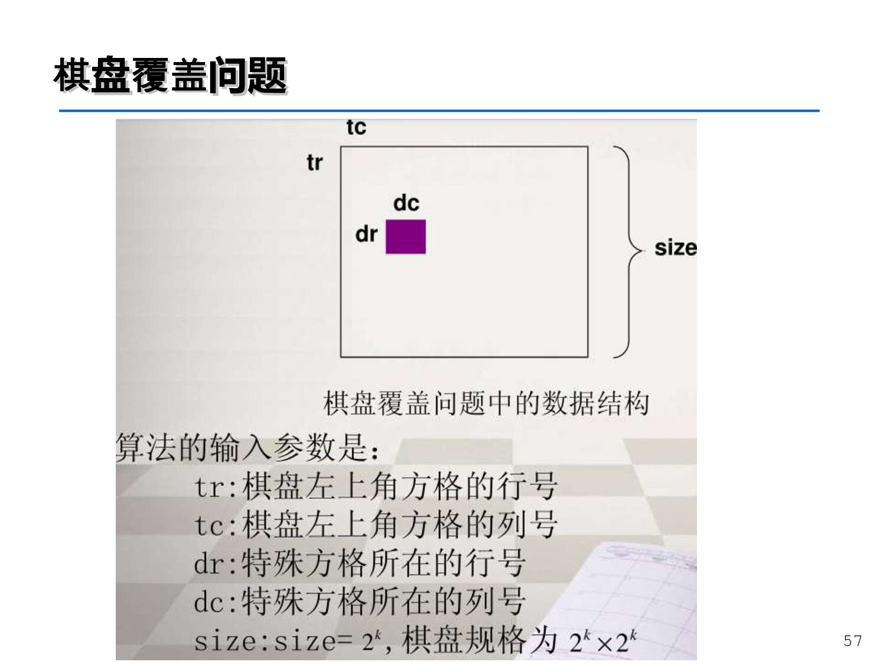

**数据结构**（PPT P56）：
- **棋盘**：用二维数组 `board[size][size]` 表示，其中 $\text{size} = 2^k$。为了在递归中使用同一个棋盘，将 board 设为**全局变量**
- **子棋盘**：用左上角的下标 `(tr, tc)` 和棋盘大小 `s` 来定位
- **特殊方格**：用 `board[dr][dc]` 表示，`(dr, dc)` 是该特殊方格在 board 中的行列下标
- **L 型骨牌**：所有骨牌从 1 开始连续编号，用全局变量 `t` 表示当前骨牌号

**算法输入参数**：
- `tr`：子棋盘左上角方格的行号
- `tc`：子棋盘左上角方格的列号
- `dr`：特殊方格所在的行号
- `dc`：特殊方格所在的列号
- `size`：棋盘规格 $2^k \times 2^k$

### 7.5 算法代码 (PPT P58-59)

```cpp
void chessBoard(int tr, int tc, int dr, int dc, int size) {
    if (size == 1) return;       // 基准情况：1×1 棋盘，无需覆盖
    int t = tile++;              // 取一个新的 L 型骨牌编号
    int s = size / 2;            // 分割棋盘

    // ① 覆盖左上角子棋盘
    if (dr < tr + s && dc < tc + s)         // 特殊方格在此子棋盘中
        chessBoard(tr, tc, dr, dc, s);
    else {                                   // 不在此子棋盘中
        board[tr + s - 1][tc + s - 1] = t;  // 用 t 号骨牌覆盖右下角
        chessBoard(tr, tc, tr + s - 1, tc + s - 1, s);
    }

    // ② 覆盖右上角子棋盘
    if (dr < tr + s && dc >= tc + s)        // 特殊方格在此子棋盘中
        chessBoard(tr, tc + s, dr, dc, s);
    else {
        board[tr + s - 1][tc + s] = t;      // 用 t 号骨牌覆盖左下角
        chessBoard(tr, tc + s, tr + s - 1, tc + s, s);
    }

    // ③ 覆盖左下角子棋盘
    if (dr >= tr + s && dc < tc + s)        // 特殊方格在此子棋盘中
        chessBoard(tr + s, tc, dr, dc, s);
    else {
        board[tr + s][tc + s - 1] = t;      // 用 t 号骨牌覆盖右上角
        chessBoard(tr + s, tc, tr + s, tc + s - 1, s);
    }

    // ④ 覆盖右下角子棋盘
    if (dr >= tr + s && dc >= tc + s)       // 特殊方格在此子棋盘中
        chessBoard(tr + s, tc + s, dr, dc, s);
    else {
        board[tr + s][tc + s] = t;          // 用 t 号骨牌覆盖左上角
        chessBoard(tr + s, tc + s, tr + s, tc + s, s);
    }
}
```

**代码核心逻辑**：
- 每次递归处理 4 个子棋盘（左上、右上、左下、右下）
- 对每个子棋盘，先判断特殊方格是否在其中：
  - **若在**：直接递归，特殊方格坐标不变
  - **若不在**：在该子棋盘靠近中心的角上放一个骨牌标记（与其他两个无特殊方格的子棋盘共同组成一个 L 型骨牌），然后以该标记位置作为"新的特殊方格"递归

### 7.6 复杂度分析 (PPT P60)

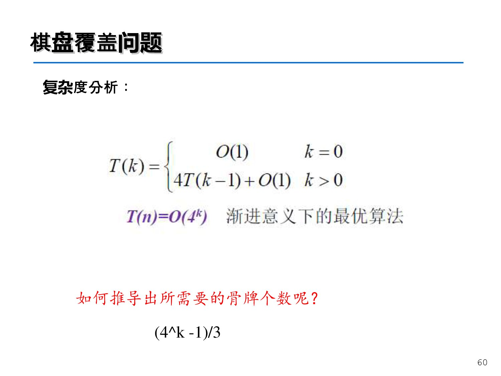

**递推关系**：

$$T(k) = \begin{cases} O(1) & k = 0 \\ 4T(k-1) + O(1) & k > 0 \end{cases}$$

- 每次递归分成 **4 个子问题**（4 个子棋盘）
- 每层递归的"额外工作"是 $O(1)$（只是放一块骨牌、做几次坐标比较）

**求解**：$T(k) = O(4^k)$

由于 $n = 2^k$（棋盘边长），所以 $4^k = (2^k)^2 = n^2$，即 $T(n) = O(n^2)$。

这是**渐进最优的**——因为棋盘共有 $n^2 = 4^k$ 个方格，需要放 $(4^k - 1)/3$ 块骨牌，每块骨牌至少需要 $O(1)$ 的操作，所以任何算法的下界就是 $\Omega(4^k)$。

---

## 📋 Summary (PPT P61)

| 算法/问题 | 方法 | 时间复杂度 | 备注 |
|:---|:---|:---|:---|
| 分治法一般形式 | $T(n) = aT(n/b) + f(n)$ | 用主定理求解 | |
| 大整数乘法 | Karatsuba（3 次乘法） | $O(n^{1.585})$ | $n^{\log_2 3}$ |
| 矩阵乘法 | Strassen（7 次乘法） | $O(n^{2.807})$ | $n^{\log_2 7}$ |
| 二分查找 | 每次规模减半 | $O(\log n)$ | 要求有序数组 |
| 归并排序 | 分-排-合 | $\Theta(n \log n)$ | 稳定排序，需 $O(n)$ 额外空间 |
| 快速排序 | Partition 划分 | 平均 $O(n \log n)$，最坏 $O(n^2)$ | 不稳定，原地排序 |
| 棋盘覆盖 | 四等分 + 中心骨牌 | $O(4^k) = O(n^2)$ | 渐进最优 |

---

## 🤔 思考题 (PPT P62)

1. 设 $a[0:n-1]$ 是一个已排好序的数组。设计搜索算法，使得当搜索元素 $x$ 在数组中时，$i$ 和 $j$ 相同，均为 $x$ 在数组中的位置；搜索元素 $x$ 不在数组中时，返回小于 $x$ 的最大元素的位置 $i$ 和大于 $x$ 的最小元素位置 $j$。并对自己的程序进行复杂性分析。

2. 给定 2 个大整数 $u$ 和 $v$，分别有 $m$ 位和 $n$ 位数字，且 $m \leq n$。用通常的乘法求 $uv$ 的值需要 $O(mn)$ 时间。当 $m$ 比 $n$ 小得多时，试设计一个算法，在上述情况下用 $O(nm^{\log(3/2)})$ 时间求出 $uv$ 值。

