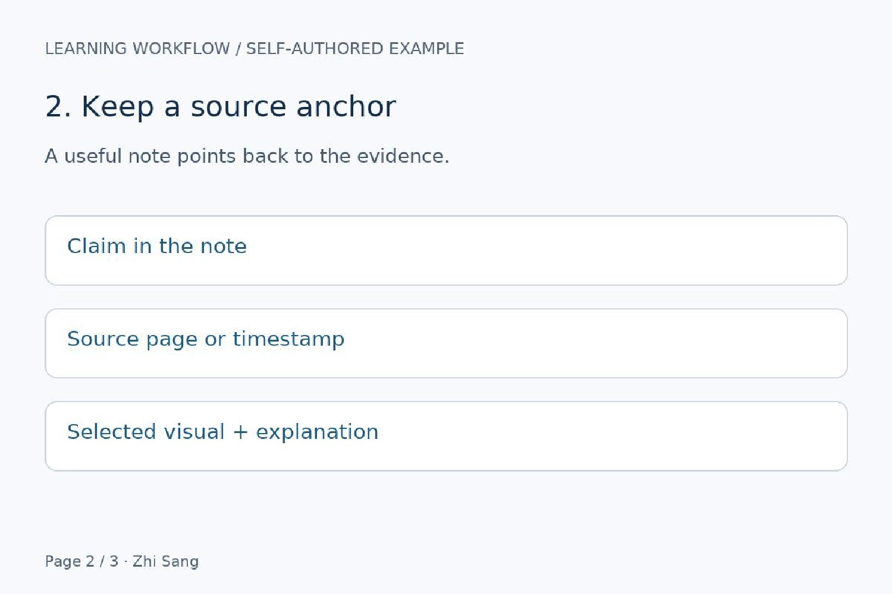

# 从资料到可回查的笔记

来源：[自制课件](input/slides.pdf)，共三页。本文是仓库演示笔记，示例图由公开工具实际转换。

## 1. 先保留材料中的视觉信息（P1）

课件中的图表、公式和版式参与表达。转换成页图后，先用拼接预览了解结构，再检查看不清的单页。拼接图适合浏览，具体符号和条件仍需要局部核对。

## 2. 笔记应能回到具体来源（P2）

一个结论除了说明本身，还要保留它的依据。文档材料可以标页码，视频材料可以标时间；图片附近应说明它与正文的关系。

图示来源：自制课件 P2。三个框分别对应正文中的结论、可回查的来源位置，以及用来解释结论的视觉材料。来源锚点帮助复核，正文负责讲清含义。

## 3. 输出后再检查（P3）

检查分为三类：术语与条件是否准确、图片是否可读、实质内容是否覆盖。工具执行转换和文件处理，AI 助手与用户结合原件完成理解和核对。
