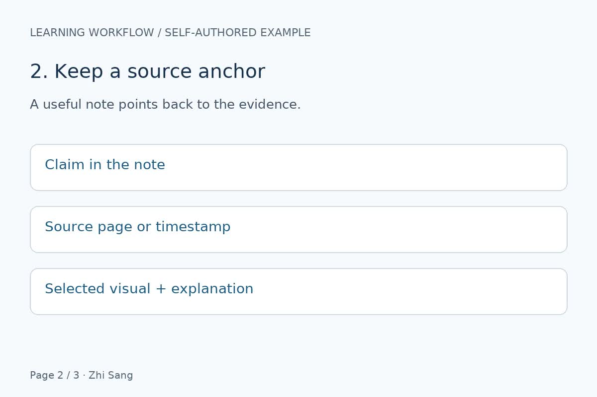

# 资料整理流程：视频示例

来源：[15 秒无声演示视频](input/silent-workflow.mp4)。画面、字幕和时间索引由 `build_demo.py` 人工定义并生成，展示时间查询与抽帧流程。

| 时间 | 主题 |
| --- | --- |
| 00:00–00:05 | 保留来源材料的视觉信息 |
| 00:05–00:10 | 为笔记增加来源锚点 |
| 00:10–00:15 | 复核术语、图片与覆盖范围 |

## 来源锚点（00:05–00:10）

索引 `S00002` 对应第二个画面。运行查询得到这个区间后，在 00:06 抽取一帧：

该帧在主题区间内，三个信息块均已显示。真实视频应根据讲解和画面出现的时间调整候选帧，实际查看后再选图。

这个示例验证索引查询、画面定位和 Markdown 配图。ASR 与 Forced Aligner 的模型推理需要单独部署并验证。
